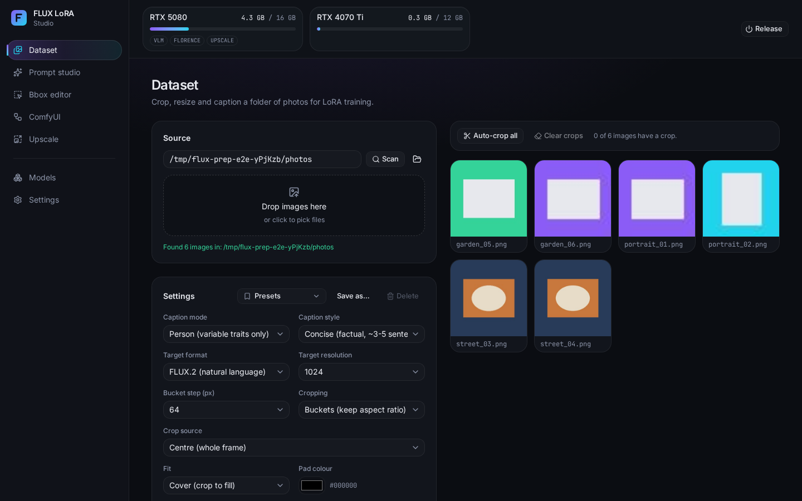
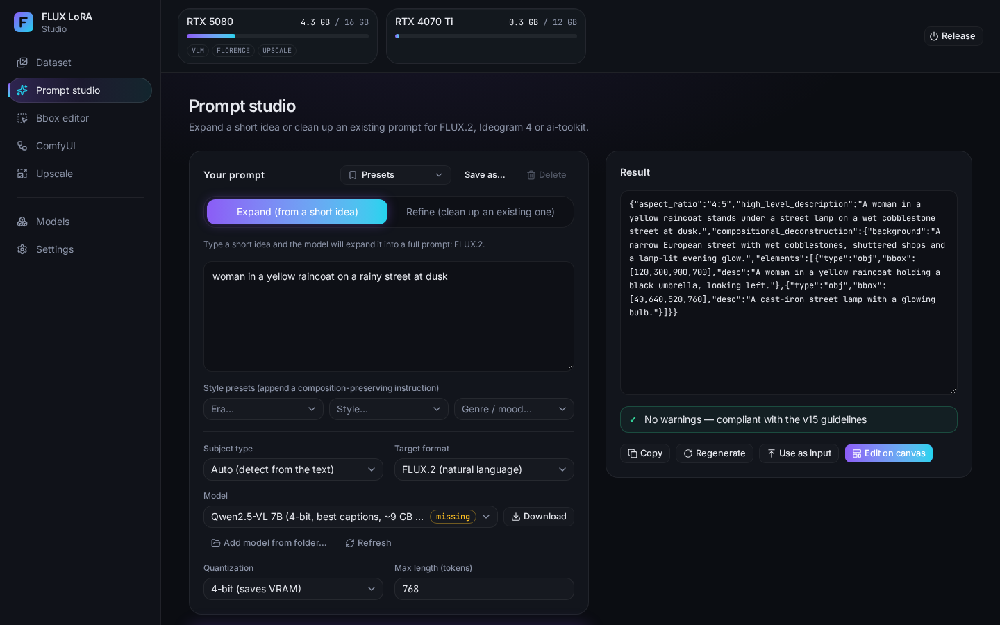
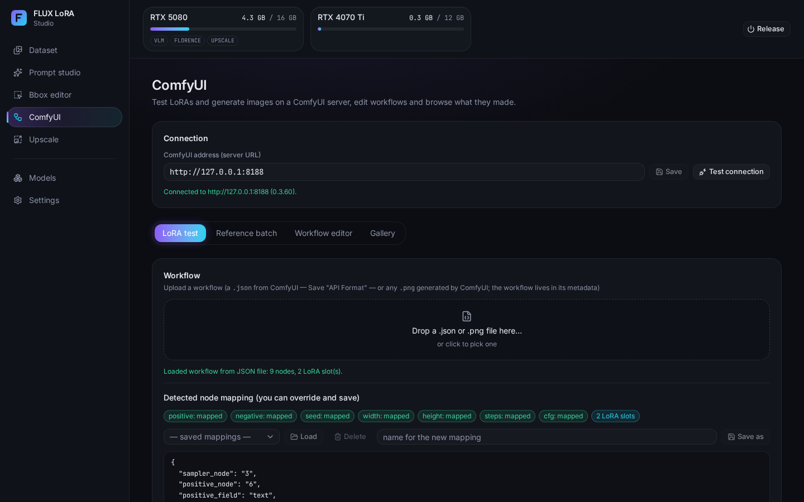
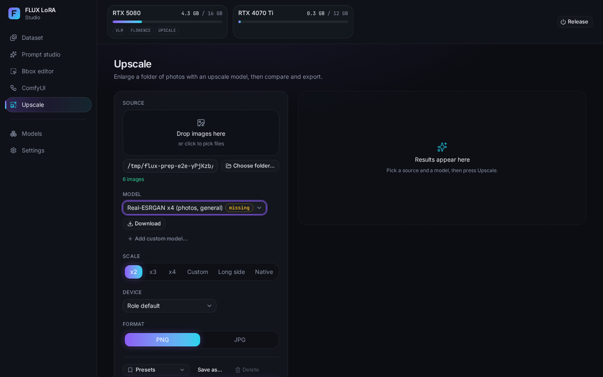
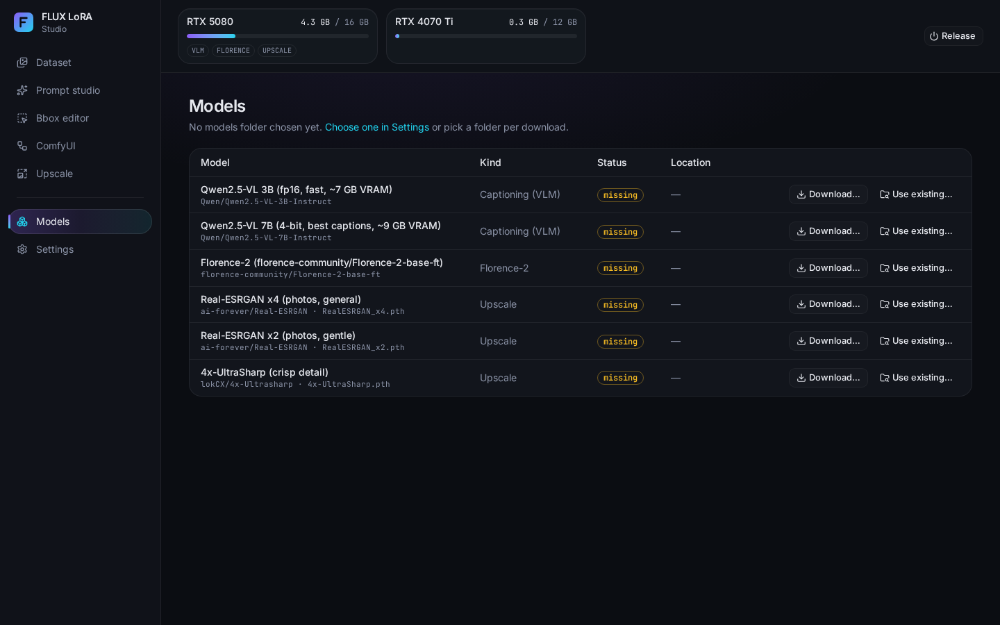
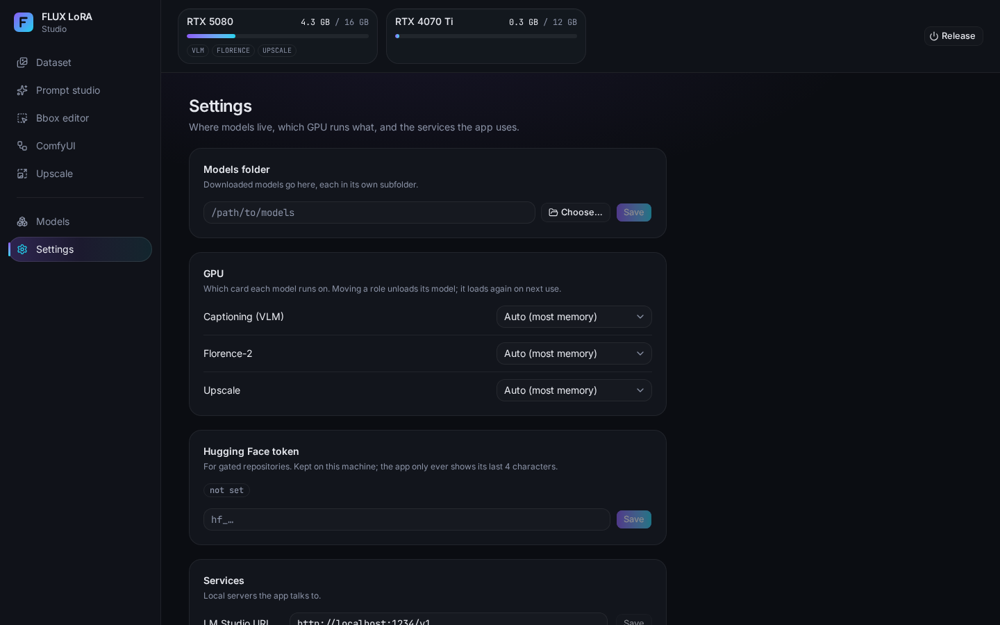

# FLUX LoRA Studio

A browser-based, fully local toolbox for FLUX LoRA training and Ideogram 4
prompting. One app, seven views:

- **Dataset** — prepare a LoRA training dataset: crop, resize and rename photos,
  then caption them with a local vision model.
- **Prompt studio** — expand or refine generation prompts for FLUX.2 or
  Ideogram 4, with a prompt library.
- **Bbox editor** — lay out Ideogram 4 (v15) prompts visually and render them
  on ComfyUI.
- **ComfyUI** — LoRA tests, reference batches, a workflow editor and a gallery.
- **Upscale** — batch super-resolution with before/after preview.
- **Models** and **Settings** — where the local models live and which GPU runs
  what.

Everything runs on your machine; the server listens on `127.0.0.1` only.

## Screenshots

**Dataset** — source folder, thumbnails and dataset settings:



**Prompt studio** — expanding a short idea into an Ideogram 4 (v15) prompt:



**Bbox editor** — the v15 canvas with the live linter:


**ComfyUI** — connection, LoRA test and detected node mapping:



**Upscale** — source folder, model and scale picker:



**Models** — every local model with its status and location:



**Settings** — models folder, GPU per role, tokens and service URLs:



## Requirements

- Linux / WSL2 (tested: WSL2 + RTX 4070 Ti, 12 GB VRAM)
- [`uv`](https://docs.astral.sh/uv/) — manages Python 3.12 and the dependencies
- Node and [`pnpm`](https://pnpm.io/installation) — **required**: the UI is
  built from `web/` and is not committed. Without `web/dist`, `/` answers 503
  with the build command.
- An NVIDIA GPU with CUDA (CPU works too, but captioning is very slow)
- For rendering: a ComfyUI server with the Ideogram 4 nodes
  (`Ideogram4Scheduler`, `DualModelGuider`, `CFGOverride`,
  `EmptyFlux2LatentImage`) and the Ideogram 4 / FLUX.2 model files
- A Hugging Face token (Settings) is only needed for **gated** repos; the
  built-in upscale models download anonymously

## Running

```bash
cd flux-lora-prep
./run.sh
```

Then open **http://127.0.0.1:8123** (override with `PORT`).

`run.sh` creates the virtualenv, installs the Python dependencies and runs
`pnpm install` + `pnpm build` in `web/` when `web/dist` is missing or older than
its sources. A failed build does not stop the server: it starts with the
previous build, if there is one.

`launch.sh` is the one-click variant: if the server already answers on `PORT` it
only opens the browser, otherwise it starts `./run.sh` and opens the browser as
soon as the server is up (it waits up to 30 minutes, since the first run
installs PyTorch). Point a desktop launcher (`.desktop` file or shortcut) at
`launch.sh`.

Old `/legacy/` bookmarks redirect to the app.

Development, with hot reload (the backend must run on 8123):

```bash
cd web && pnpm dev        # proxies /api to 127.0.0.1:8123, open http://localhost:5173
```

Checks:

```bash
.venv/bin/python -m pytest -q
cd web && pnpm typecheck && pnpm build && pnpm exec playwright test
```

`FLUX_PREP_WORK` relocates all state (settings, jobs, databases; default
`.work/`) — the e2e tests use it to stay out of your real data. The screenshots
in `docs/screenshots/` are regenerated on that e2e server with
`SCREENSHOTS=1 pnpm exec playwright test e2e/screenshots.spec.ts`.

## Models folder (set it first)

The local models (Qwen2.5-VL, Florence-2, the upscalers) live in one **Models
folder**. Set it before the first captioning, **From image** or upscale run:
Settings → **Models folder** (an absolute path) → **Save**. Until then a model
that has to be downloaded fails with *No models folder chosen*. A missing model
downloads into it on first use (the VLM a few GB, Florence-2 ~0.7 GB), with
progress in the job status, as a plain folder named `<owner>--<repo>` (e.g.
`Qwen--Qwen2.5-VL-7B-Instruct`). The app never downloads anywhere else and
never deletes model files — **Forget** only removes the entry.

The **Models** view lists every model with its status and location, and offers
**Download…**, **Use existing…**, **Forget** and **Cancel**. Models you already
have are used without a download when they are in the Models folder or in a
Hugging Face cache (the default one, or the one `HF_HOME` points at).

A VLM or Florence snapshot that you **copied into the Models folder by hand** is
not recognised on its own, because only the app writes the completion marker:
point the app at it with **Use existing…** (`POST /api/store/locate`).

Coming from v1: v1's `run.sh` set `HF_HOME=/mnt/intel/huggingface`. To reuse
those weights without downloading again, `export HF_HOME=/mnt/intel/huggingface`
before `./run.sh`, or use **Use existing…**.

## The views

### Dataset

1. **Source** — a folder (folder picker or typed path) or drag-and-drop upload
   (HEIC included), shown as a thumbnail grid. Click a thumbnail for the crop
   editor: drag and resize the box with ratio Free / 1:1 / 3:4 / 4:3 / 16:9.
   **Auto (Florence)** only moves the box (nothing is kept until Save), **Apply
   to same ratio** copies it to photos with that ratio, **Reset** restores the
   default. **Auto-crop all** recomputes the crops for every photo (it asks
   first only when crops already exist; photos with no detection keep theirs);
   **Clear crops** drops them. Crop plans and the chosen crop source are stored
   per folder on the server (`.work/crop_plans.json`).
2. **Settings** — caption mode and target format, resolution (768 / 1024 / 1280 /
   1536), bucket step, output format, crop source, **cover** / **contain** fit,
   the upscale model used when a crop is smaller than the target, the VLM (3B
   fast / 7B best, or any LM Studio model), quantization and an optional
   *trigger word*. The form autosaves; named presets leave out the folder,
   trigger word, output folder and crop source.
3. **Process** — resizes and (optionally) captions, with progress that survives
   leaving the view.
4. **Review** — check thumbnails and edit any caption by hand (edits are kept
   in the browser tab until export). Remove has an Undo.
5. **Export** — to a folder or a `.zip`.

Crop source: **centre** (with left/right/top/bottom centring), **auto**
(Florence-2 finds the subject) or **manual** (the saved crop plan). When a
chosen crop is smaller than the computed target size it is upscaled through the
selected upscale model before the final cover/contain fit.

### Prompt studio

Pick **Expand** (a short idea into a full prompt) or **Refine** (clean up an
existing or tag-style prompt), type the subject, choose the target — **FLUX.2**
(natural prose), **Ideogram 4 JSON** or **ai-toolkit JSON** — and for the JSON
targets the element count and description density. The Era / Style / Genre
selects append a composition-preserving instruction. The model (a local VLM or
any LM Studio model), quantization and max length are set per run.

Generation is a background job and survives leaving the view. The result is
editable (a JSON result is re-linted on edit); **Copy**, **Regenerate**, **Use as
input** and **Edit on canvas** (opens it in the Bbox editor) sit under it. Every
result lands in the **prompt library** (SQLite) with All / FLUX.2 / Ideogram
tabs, filter, copy, open on canvas, delete and **Export .sql**.

### Bbox editor

The canvas drags boxes and resizes them with 8 handles; clicking a spot again
cycles overlapping boxes. With the canvas focused, arrows move the selected box
1 unit (Shift: 10), Delete removes it, Escape deselects. Aspect presets: 1:1,
4:5, 9:16, 16:9, 3:1 or a custom W:H. The side panel has the `aspect_ratio`,
high-level description and background fields and one card per element (numbered
like the server lint, with word counters and ▲▼ z-order); the prompt is linted
live.

Start from **Paste JSON** (old schemas, `caption`/`data` wrappers and
double-encoded JSON are converted), **From image**, or **Edit on canvas** from
Prompt studio or the library. **From image** runs as a background job with three
engines:

| Engine | Bboxes | Descriptions | Cost |
|--------|--------|--------------|------|
| **Florence-2** (default) | measured (object detection + OCR) | terse labels | ~1 GB VRAM, fast |
| **VLM only** | estimated by the vision model | full v15 prose | the chosen VLM |
| **Hybrid** | measured by Florence-2, kept verbatim | rewritten by the VLM to full v15 prose | both models |

Then **Save to library**, **Copy** (minified or Pretty), **Download**
(`caption_v15.json`) or render. The draft lives in the browser tab.

**Ideogram 4 render.** The built-in workflow needs no `.json` upload: pick a
quality preset (Quality 48 / Default 20 / Turbo 12 steps), megapixels, seed,
the scheduler (the community *simple* AuraFlow+euler one, or the original
*Ideogram 4* scheduler), batch, an optional model-only LoRA and advanced models,
then render with a live preview and a results grid. Lint errors block the
render unless you press **Render anyway**. The prompt text is prefixed with an
explicit orientation statement (`LANDSCAPE orientation: … 1776x1184 pixels … do
not rotate or mirror the layout`) with the exact output size, computed with the
workflow's own math; without it the model tends to rotate or squash the layout.
**Cancel** removes your prompt from the ComfyUI queue, or sends a targeted
`/interrupt` if it is already running.

### ComfyUI

A connection card holds the server URL (same value as in Settings; **Test
connection** saves it first). Four tabs, kept in the URL as `?tab=`:

- **LoRA test** — a workflow (`.json` in API format, or a ComfyUI `.png` with the
  workflow embedded) plus a mapping JSON saying which node input is the prompt,
  seed, size and so on. One LoRA row per LoRA slot, matched by position (a blank
  row leaves its slot as in the workflow). Prompts and mappings have libraries.
- **Reference batch** — one image per prompt line, one after another; survives
  navigation and reload, stops on the first error, Cancel skips the rest.
- **Workflow editor** — every node as a card with its inputs (dropdowns from
  ComfyUI's node schemas), a graph view highlighting the executing node, and a
  workflow library; **Save .json** and **Reload from disk**.
- **Gallery** — images newest first with a source badge (LoRA test, Editor,
  Ideogram); a single image has a deep link `?tab=gallery&image=<id>`.

Names in the ComfyUI libraries (mappings, workflows, prompts) cannot contain
`/` — including when importing; older names that already have one stay
reachable.

### Upscale

Pick a source folder (or drop images), a model and a scale: **x2 / x3 / x4**, a
**custom factor** (1.5–8; model passes, then Lanczos to the exact size), a
**long side** in pixels, or the model's **native** scale. The GPU can be set per
job (or left at the role default). Results show a before/after preview and
export to a folder or a `.zip`. Built-in models: Real-ESRGAN x2/x4 and
4x-UltraSharp; **Add custom model…** takes an HF repo id + filename or a local
weights file (its folder is scanned for `.pth` / `.safetensors`), and
**Remove custom model** removes a custom Hugging Face entry only (never a
file); models found by scanning a local folder get no remove button. Autosaved form and
named presets.

### Models and Settings

**Models** is described above. **Settings** holds the Models folder, the GPU per
role, the Hugging Face token, the LM Studio and ComfyUI URLs, and settings
export/import (the export never contains the token). A first-run onboarding
points at the Models folder.

## GPU: one card per role, one job at a time

The local models run on a card per **role** — **VLM**, **Florence-2** and
**Upscale** — each set to a card, `cpu` or `auto` (the card with the most
memory, the default; CPU is not offered for the VLM). Cards are listed by name
and memory (e.g. `RTX 5080 · 16 GB`), never by CUDA number, which can disagree
with `nvidia-smi`. Choices are remembered by the card's UUID (a card that is gone
falls back to `auto`), and a change releases the affected model so it reloads on
the new card. The top bar shows each card's load and a **Release** button that
unloads the models. ComfyUI and LM Studio are separate processes with their own
GPU settings.

**Processing in progress.** Only one job that uses a local model (VLM, Florence
or an upscaler) runs at a time, on GPU or CPU. Starting another one while it
runs is refused with 409 *Processing in progress — wait for it to finish.*
Jobs that only talk to LM Studio are exempt.

## Local API and security

Settings (Models folder, per-role GPUs, saved forms and presets) are kept in
`.work/settings.json`. The API answers only the app itself: requests with a
non-loopback `Host`, and state-changing requests from another web origin, get
403. An origin is accepted when it is a loopback address on the server's port
or exactly one of `FLUX_PREP_DEV_ORIGINS` (comma-separated, empty by default;
the Vite dev proxy needs no entry). curl and scripts that send no `Origin`
header work as before. `GET /health` returns `{"ok": true, "version": …}`.

## Output format

```
dataset/
├── person_0000.png
├── person_0000.txt   # "ohwx person, <detailed caption…>"
├── person_0001.png
├── person_0001.txt
└── …
```

Ready for kohya_ss, ai-toolkit, SimpleTuner etc. The Ideogram format
additionally writes a pretty `person_0000.json`.

## Model choice and memory (RTX 4070 Ti, 12 GB)

| Model              | Mode     | VRAM   | Notes                                  |
|--------------------|----------|--------|----------------------------------------|
| Qwen2.5-VL-3B      | fp16     | ~7 GB  | Fast, good                             |
| Qwen2.5-VL-7B      | 4-bit    | ~9 GB  | Best, most detailed captions (default) |
| Florence-2-base-ft | fp16     | ~1 GB  | Image → v15 draft (bboxes + OCR)       |

Any OpenAI-compatible local server also works for text/caption generation via
**LM Studio** (set its URL in Settings and pick a `lmstudio:` model).

## Caption modes

| Mode | Describes | Skips (so the trigger absorbs it) |
|------|-----------|-----------------------------------|
| **Person** | what varies between photos: pose, expression, clothing, framing, background, lighting | the fixed face/identity |
| **Person — details** | rich physical detail: age, build, marks (scars/moles/tattoos), hair, skin | — (full likeness, for non-trigger use) |
| **Style** | only the content & composition (subjects, objects, layout) | the art style, medium, palette and grading — for a **style LoRA** |
| **Architecture / Landscape / Generic** | subject, materials, setting, framing, light | — |

The same modes drive both the FLUX.2 prose captions and the Ideogram 4 JSON
captions.

## Caption style (FLUX.2)

Captions are written as full natural sentences (FLUX.2 has an LLM text
encoder), focused on spatial relationships and actions, with no judgemental
words. The **person** and **style** modes use the same residual trick: they
describe everything *except* the thing the trigger word should learn (the
person's likeness, or the art style), so that signal is attributed to the
trigger during training.

## Ideogram 4 dataset captions (v15 + bboxes)

When the target format is **Ideogram 4 JSON** (or ai-toolkit), dataset captions
use the same v15 framework as the Prompt studio and the Bbox editor, so every
element carries a `[y1,x1,y2,x2]` bbox on the 0–1000 grid. The VLM estimates
each element's position from the photo; the result is structurally normalized in
Python (key order, aspect ratio from the image, bbox sanity) and the trigger
word is injected into `high_level_description` at export. Each image yields a
minified `.txt` plus a pretty `.json`. Load any of these into the **Bbox
editor** to fine-tune the boxes.

## Ideogram v15 in one paragraph

The studio and the editor target the v15 caption framework: exactly three
top-level keys (`aspect_ratio`, `high_level_description`,
`compositional_deconstruction` with `background` + `elements`), no
`style_description`/`color_palette` (style, light and medium are woven into
the prose), one subject = one element with parts inside its `desc`,
floor/sky/weather live only in `background`, bboxes are `[y1,x1,y2,x2]` on a
0–1000 grid normalized per axis, literal strings go into `text` elements
verbatim, and hedging ("various", "such as", "or") is banned. The built-in
linter (server-side and live in the editor) flags violations of these rules.

## Bucketing notes

The "buckets" mode keeps aspect ratios: it picks dimensions that are multiples
of the step (e.g. 64) with a pixel count close to `resolution²`, then fits the
photo (cover + center crop). The "square" mode crops everything to
`resolution × resolution`.

## Project layout

```
backend/
├── server.py             # wires the FastAPI app: routers, middleware, SPA
├── core.py               # shared state: paths, jobs, the GPU busy guard
├── api_system.py         # /health, GPU status and roles, LM Studio, filesystem
├── api_models.py         # model store: list, download, locate, forget
├── api_settings.py       # settings, presets, export/import
├── api_dataset.py        # scan, crop, process, review, export
├── api_upscale.py        # upscale jobs and custom models
├── api_prompts.py        # prompt jobs, library, lint
├── api_ideogram.py       # normalize, analyze (From image), render
├── api_comfy.py          # ComfyUI config, LoRA test, editor, gallery
├── captioner.py          # local VLM (Qwen2.5-VL) loading + generation
├── florence.py           # Florence-2: image -> v15 draft (bboxes + OCR)
├── upscaler.py           # super-resolution pipeline (spandrel)
├── prompts.py            # caption/prompt instructions + v15 normalizer
├── v15_lint.py           # server-side v15 prompt linter
├── lmstudio.py           # LM Studio (OpenAI-compatible) client
├── ideogram_workflow.py  # built-in Ideogram 4 ComfyUI graph builder
├── comfy_client.py       # ComfyUI HTTP/WS client
├── comfy_workflows.py    # workflow parsing (.json / .png metadata)
├── model_store.py        # Models folder and model status
├── settings.py, gpu.py, hf_auth.py, origin_guard.py, crop_store.py,
│   crop_auto.py, image_utils.py, fsutil.py
web/                      # the UI: React + Vite + TypeScript (built to web/dist)
├── src/                  # app shell, pages, components
└── e2e/                  # Playwright tests (and the screenshots spec)
tests/                    # pytest
run.sh, launch.sh         # start the server (and open the browser)
```
