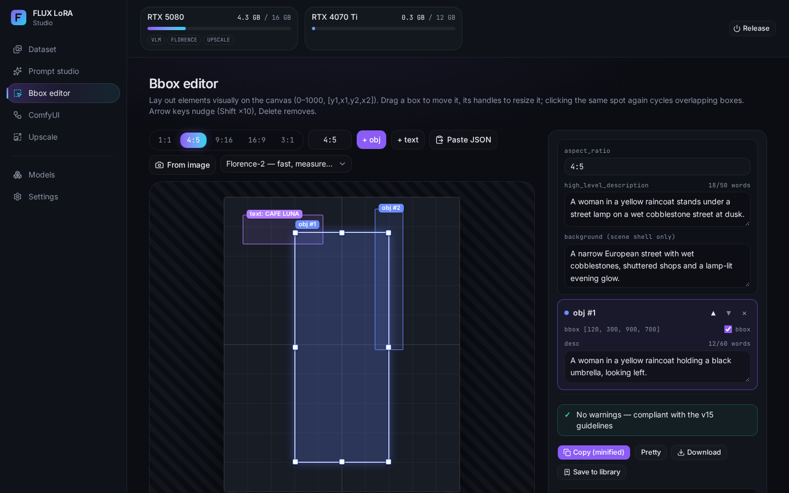

# Ideogram4 FLUX2 LoRA — dataset & prompt studio

A browser-based, fully local toolbox for FLUX LoRA training and Ideogram 4
prompting:

- **📸 Dataset (captions)** — prepares a LoRA training dataset: unifies
  **sizes** (bucketing / square crop), **format** (PNG/JPG) and **file names**,
  and captions the photos with a local vision model (Qwen2.5-VL) in one of the
  modes: **person**, **person — details**, **style** (content-only, for a style
  LoRA), **architecture**, **landscape** or **generic**. Captions can be plain
  FLUX.2 prose, Ideogram 4 JSON or ai-toolkit JSON; Ideogram captions use the
  v15 framework and carry per-element **bboxes**, exactly like the bbox editor.
  Cropping has four modes: **centre** (with left/right/top/bottom centring
  choices), **auto** (Florence-2 finds the subject), **manual** (drag a crop
  rectangle per photo) and **batch** (**✂ Auto-crop all** recomputes and
  replaces crops for every photo, with a confirmation first); either
  **cover** (crop to fill) or **contain** (pad with a colour) fit. When the
  chosen crop is smaller than the computed target size, it is upscaled
  through the selected upscale model before that final cover/contain fit.
- **✨ Prompt studio** — writes generation prompts for you. *Expand* turns a
  short idea into a full layered prompt; *Refine* cleans up an existing or
  tag-style prompt. Targets **FLUX.2** (natural prose) or **Ideogram 4 JSON**
  (the **v15 framework**: `aspect_ratio` + `high_level_description` +
  `compositional_deconstruction`, one-subject-one-element, background-as-shell,
  0–1000 bboxes). Ideogram output is structurally normalized in Python and
  checked by a built-in **v15 linter**; element-count / description-density
  controls and composition-preserving **style presets** (era / style / genre)
  steer the generation. Every prompt is auto-saved to a **SQLite prompt
  library** with one-click copy and `.sql` export.
- **🧩 Bbox editor** — a visual canvas for Ideogram v15 prompts: drag and
  resize element boxes on an aspect-ratio-true 0–1000 grid, edit obj/text
  cards with live word counters and a live v15 linter, import old/broken/
  double-encoded JSONs (they get unwrapped and converted), or start from a
  **reference photo** with a choice of three analysis engines: **Florence-2**
  (fast, measured bboxes + OCR), **VLM only** (Qwen2.5-VL or any LM Studio
  vision model drafts the whole JSON) or **Hybrid** (Florence's measured
  bboxes + the VLM's rich v15 prose). The current canvas renders directly on
  your ComfyUI server with a **built-in Ideogram 4 workflow** (quality
  presets, both scheduler variants, optional LoRA), with an explicit
  orientation cue that stops the model from rotating or squashing the layout.
- **🎨 ComfyUI** — generic ComfyUI integration: LoRA testing with any uploaded
  workflow, reference-image batches, a node/parameter workflow editor with a
  graph view and a SQLite workflow library, plus a persistent gallery.
- **🔍 Upscale** — a standalone tab for batch super-resolution: pick a
  built-in Hugging Face model (Real-ESRGAN x2/x4, 4x-UltraSharp) or add your
  own by **HF repo id + filename**, or point at a **local folder** of weights
  (e.g. ComfyUI's `models/upscale_models`) which is scanned for `.pth` /
  `.safetensors` files. Target either the model's **native scale**, a fixed
  **x2**, or a **long-side pixel count** (the pipeline runs extra passes and
  downsamples to hit it); export the results to a folder or a `.zip`, same as
  the dataset tab. Through the API, `POST /api/upscale/run` also takes
  `"mode": "factor"` with any `"factor"` above 1 up to 8 (x2, x3, x4, 1.5…:
  model passes, then Lanczos down to the exact size) and a per-job `"device"`
  (`"cpu"`, a card's UUID, or empty for the Upscale role's card); the new
  v2 Upscale view offers both, the classic tab does not.

The top bar shows the GPU status (loaded model and VRAM usage) and a
**⏏ Release GPU** button that unloads the models from the card. The local
models run on a card per **role** — **VLM**, **Florence-2** and **Upscale** —
each set to a card, `cpu` or `auto` (the card with the most memory, the
default). On a machine with more than one NVIDIA card, a picker in the top bar
lists the cards **by name and memory** (e.g. `RTX 5080 · 16 GB`) — never by
CUDA number, which can disagree with `nvidia-smi` — and puts all three roles
on the chosen card. To give one role its own card, call
`POST /api/gpu/assign` with `{"role": …, "device": …}` — role `vlm`,
`florence` or `upscale`; device `auto`, `cpu` or a card's UUID
(`GET /api/gpus` lists the cards and the roles); only that role's model is
released. Choices are remembered by the card's UUID (a card that is gone falls
back to `auto`), and a switch releases the affected models so they reload on
the new card. ComfyUI and LM Studio are separate processes and keep their own
GPU settings.

## Screenshots

**📸 Dataset (captions)** — source images, dataset settings and captioning:


**✨ Prompt studio** — expanding/refining prompts for FLUX.2 and Ideogram 4
(v15), with the prompt library below:


**🧩 Bbox editor** — visual v15 canvas with the live linter and the built-in
Ideogram 4 render panel:



**🎨 ComfyUI** — configuration, LoRA test, reference batches, workflow editor
and gallery:


**🔍 Upscale** — the standalone batch super-resolution tab: source folder,
model + target-size picker and export:


## Requirements

- Linux / WSL2 (tested: WSL2 + RTX 4070 Ti, 12 GB VRAM)
- [`uv`](https://docs.astral.sh/uv/) (manages Python and the dependencies)
- An NVIDIA GPU with CUDA (CPU works too, but captioning is very slow)
- `spandrel` (installed by `requirements.txt`) loads the super-resolution
  weights for auto-crop upscaling and the **🔍 Upscale** tab
- For rendering: a ComfyUI server with the Ideogram 4 nodes
  (`Ideogram4Scheduler`, `DualModelGuider`, `CFGOverride`,
  `EmptyFlux2LatentImage`) and the Ideogram 4 / FLUX.2 model files
- A Hugging Face token (set it in the Dataset settings or the Upscale tab) is
  only needed for **gated** upscale repos; the built-in models download
  anonymously

## Running

```bash
cd ~/flux-lora-prep
./run.sh
```

Then open **http://127.0.0.1:8123**.

`launch.sh` is the one-click variant (it is what a desktop shortcut should
run): if the server already answers on `PORT` (default 8123) it only opens the
browser, otherwise it starts `./run.sh` and opens the browser as soon as
`/api/models` responds.

### New UI (v2)

`/` serves the new UI (built from `web/` into `web/dist`); the classic UI
stays at **`/legacy/`** (it understands a `#<view>` hash, e.g.
`/legacy/#prompts`). If `web/dist` does not exist, `/` redirects to
`/legacy/`. `run.sh` runs `pnpm install` and `pnpm build` in `web/` when
`web/dist` is missing or older than its sources (`web/src`, `web/public`,
`web/index.html`, `package.json`, `pnpm-lock.yaml`, `vite.config.ts`); without
`pnpm` it prints a message and skips the build, so you get the classic UI
only. A failed build does not stop the server: `run.sh` prints a message and
starts it with the previous build, or with only the classic UI if there is
none. `launch.sh` waits up to 30 minutes for the server, since the first run
installs PyTorch.

The v2 views so far: **Upscale** (x2 / x3 / x4, a custom factor 1.5–8, long
side or native scale; model and GPU per job; drag-and-drop; before/after
preview; export to a folder or `.zip`; autosaved form and named presets),
**Models** (Download… / Use existing… / Forget / Cancel) and **Settings**
(Models folder, GPU per role — CPU is not offered for the VLM — Hugging Face
token, LM Studio and ComfyUI URLs, settings export/import), plus a first-run
onboarding. ComfyUI is in v2 as well (below), so every view now lives in v2; the classic UI stays at `/legacy/` until Phase 9 removes it.

**ComfyUI** is in v2 too (`/comfy`). A connection card holds the server URL
(the same value as in Settings; **Test connection** saves it first). Below it
four tabs, kept in the URL as `?tab=`: **LoRA test**, **Reference batch**,
**Workflow editor** and **Gallery**. Jobs survive tab switches and navigation.

**LoRA test** takes a workflow (`.json` in API format, or a ComfyUI `.png`
with the workflow embedded) and a mapping JSON that says which node input is
the prompt, seed, size and so on; mapped and unmapped fields get badges, and
mappings can be saved in a library. There is one LoRA row per LoRA slot in
the workflow, matched by position: a blank row leaves its slot as it is in the
workflow. The LoRA list is loaded from the server automatically, prompts have
a library, and **Generate samples** shows progress and a preview and can be
cancelled. There is no LoRA strength control, same as in the classic UI.

**Reference batch** makes one image per prompt line, one after another. It
survives navigation and a page reload: each line is sent once, and a line
interrupted while it was being queued is marked unknown and skipped. It stops
on the first error, and Cancel skips the remaining lines.

**Workflow editor** shows every node as a card with its inputs; dropdowns come
from ComfyUI's node schemas (including V3 COMBO specs), number fields keep
their type, and an invalid field blocks Generate. A graph view highlights the
node that is executing. The library saves, imports, loads and deletes
workflows; actions that would replace the workflow ask first when there are
unsaved edits, and an import that would overwrite a name asks too. **Save
.json** downloads the workflow and **Reload from disk** re-reads the file.

**Gallery** lists images newest first with a source badge (LoRA test, Editor
or Ideogram); the dialog has copy, arrows, download and delete. A single image
has a deep link: `?tab=gallery&image=<id>`.

Backend changes behind it: ComfyUI errors are in English; `GET
/api/comfy/gallery` is sorted by time and each item has `source`, `width` and
`height`; `GET /api/comfy/object_info?refresh=1` skips the node-schema cache;
the ComfyUI config is written atomically under a lock; and library names with
`/` are rejected (older ones stay reachable).

**Dataset** is in v2 too. The source is a folder scan (folder picker, or
drag-and-drop upload; HEIC is accepted), shown as a thumbnail grid. The crop
editor drags and resizes the box with a ratio of Free / 1:1 / 3:4 / 4:3 / 16:9;
**Auto (Florence)** only moves the box (nothing is kept until Save), **Apply to
same ratio** copies it to the other photos with that ratio and **Reset**
restores the default box. The **Crop source** (Centre / Auto / Manual) is stored per folder
together with the crop plan. **Auto-crop all** asks for confirmation only when
crops already exist, and photos with no detection keep their crop; **Clear
crops** drops them all. Crop plans live on the server in
`.work/crop_plans.json` (`GET`/`PUT /api/crops`, keyed by the resolved folder);
a plan made in the classic UI (`localStorage` key `cropPlan:<folder>`) is
imported once, when the server has no record for that folder. The settings form
autosaves; presets leave out the folder, trigger word, output folder and crop
source. `ProcessRequest` validates numbers and enums and answers 422 with a
readable message. Processing shows progress that survives leaving the view.
Caption edits are kept in the browser tab (`sessionStorage`) until export;
export sends only the edited captions plus the removed indices. Remove has an
Undo, and export goes to a folder or a `.zip`. `GET /api/src/size` reports the
pixel size of one source image after EXIF rotation, read from its header.

**Prompt studio** is in v2 too (`/prompts`). Pick Expand or Refine, type the
subject, choose the target (FLUX.2, Ideogram 4 JSON or ai-toolkit JSON) and,
for the JSON targets, the element count and description density. The Era /
Style / Genre selects append an instruction to the request; model (any VLM or
LM Studio), quantization and max length are set per run.

Generation runs as a background job: `POST /api/prompt/jobs` returns a
`job_id`, `GET /api/prompt/jobs/{id}` reports `pending`, `loading_model`,
`generating`, `done` or `error`. It survives leaving the view. A prompt job
on a local model gets 409 while any other job is running (an `lmstudio:` model
never does). The other GPU starters (`/api/process`, `/api/crop/auto`,
`/api/upscale/run`, `/api/ideogram/analyze` and the legacy `/api/prompt`) do
not check yet.
The prompt text lives only in the browser tab (`sessionStorage` key
`flux.prompts.run`), not in `settings.json` or presets. The legacy
`POST /api/prompt` is unchanged.

The result is editable; a JSON result is re-linted on edit
(`POST /api/prompts/lint`). **Copy** falls back to a temporary textarea on
plain http, **Regenerate** reruns the job (the previous result and its edit
stay until the new one succeeds), **Use as input** moves the result into the
prompt field and **Edit on canvas** (JSON results) opens it in the v2 Bbox editor (`/bbox`): the
prompt is handed over through `sessionStorage` (`flux.bbox.handoff`, consumed
once). The library below has All / FLUX.2 /
Ideogram (JSON) tabs, a client-side filter, copy, open on canvas, delete with
confirmation and **Export .sql**.

**Bbox editor** is in v2 too (`/bbox`). The canvas drags boxes and resizes them
with 8 handles; clicking a spot again cycles overlapping boxes (a drag never
changes the selection). With the canvas focused, arrows move the selected box 1
unit (Shift: 10), Delete/Backspace removes it, Escape deselects; keys with
Alt/Ctrl/Meta pass through. Aspect presets are 1:1, 4:5, 9:16, 16:9, 3:1 or a
custom W:H. The side panel has obj/text cards numbered like the server lint
(by array index), word counters, ▲▼ z-order and a bbox toggle that remembers
the box. The prompt is linted live (`POST /api/prompts/lint`).

**Paste JSON** goes through `POST /api/ideogram/normalize`: old schemas,
`caption`/`data`/`result`/`output` wrappers and double-encoded JSON are
converted, a legacy `style_description` gives a warning, and text with no
prompt is a 400. **Copy** (minified or Pretty), **Download**
(`caption_v15.json`) and **Save to library** are in the panel. The draft lives
in the browser tab (`sessionStorage` key `flux.bbox.draft`). Opening the editor
from Prompt studio asks before replacing an edited canvas, and competing
confirmations queue instead of replacing each other.

**From image** (Florence-2 / Hybrid / VLM) runs as a background job:
`POST /api/ideogram/analyze/jobs` returns a job id, `GET
/api/ideogram/analyze/jobs/{id}` reports its state. HEIC and empty-MIME uploads
are accepted (decoded by content). The draft is applied once and the editor asks
before replacing an edited canvas.

The **Ideogram 4 render** panel has the preset, megapixels, seed (with random),
scheduler, batch, LoRA and advanced models; render settings it does not show
(e.g. cfg) are preserved. Lint errors block the render unless you press
**Render anyway**. It shows a live preview and a deduplicated results grid, and
survives navigation. **Cancel** deletes your prompt from the ComfyUI queue, or
sends a targeted `/interrupt` only if it is running; a ComfyUI execution error
now ends the job as an error instead of polling forever.

Dev server with hot reload (the backend must run on 8123):

```bash
cd web && pnpm dev        # proxies /api to 127.0.0.1:8123
```

then open **http://localhost:5173**. Checks and end-to-end tests:

```bash
cd web && pnpm typecheck && pnpm build && pnpm exec playwright test
```

`FLUX_PREP_WORK` relocates all state (settings, jobs, databases; default
`.work/`) — the e2e tests use it to stay out of your real data.

### Models folder (set it first)

The local models (Qwen2.5-VL, Florence-2, the upscalers) live in one **Models
folder**. Set it before the first captioning, **📷 From image** or upscale
run: Dataset → **Settings** → **Models folder** (an absolute path) → **Save**.
Until then a model that has to be downloaded fails with *No models folder
chosen*. A model that is not there yet downloads into it on first use (the
VLM a few GB, Florence-2 ~0.7 GB), with progress in the job status, as a plain
folder named `<owner>--<repo>` (e.g. `Qwen--Qwen2.5-VL-7B-Instruct`).

Models you already have are used without a download when they are in that
folder or in a Hugging Face cache (the default one, or the one `HF_HOME`
points at), or once you point the app at their folder or weight file with
`POST /api/store/locate` (`{"model_id": …, "path": …}`; the path is checked
first). `GET /api/store/models` lists every model with its status and path.

**Coming from v1:** v1's `run.sh` set `HF_HOME=/mnt/intel/huggingface`, so
the weights it downloaded are in that cache. To reuse them without
downloading again, start with

```bash
export HF_HOME=/mnt/intel/huggingface
./run.sh
```

or set the Models folder somewhere else and let the models download there.

### Settings and the local API

Settings (Models folder, per-role GPUs, saved form values and named presets)
are kept in `.work/settings.json`. The store and its presets have an API, with
the Settings page of the v2 UI sits on top of it: `GET`/`PATCH /api/settings`,
`PUT /api/settings/forms/{view}`,
`PUT`/`DELETE /api/settings/presets/{view}/{name}`,
`GET /api/settings/export` and `POST /api/settings/import` (views: `dataset`,
`prompts`, `bbox`, `comfy`, `upscale`). The export never contains the Hugging
Face token.

The API answers only the app itself: requests with a non-loopback `Host`, and
state-changing requests from another web origin (any other site open in your
browser), are rejected with 403. An origin is accepted when it is a loopback
address on the same port as the server, or exactly one of
`FLUX_PREP_DEV_ORIGINS` (comma-separated, empty by default). The Vite dev
server needs no entry there: its proxy keeps the `Host` header, so `Host` and
`Origin` both carry port 5173. curl and scripts that send no `Origin` header
work as before.

`/api/fs/pick` (the native folder-picker dialog) is `POST`, since it has a
side effect. The upscale result of image `idx` in a job is served at
`/api/upscale/image/{job}/{idx}`.

## How it works (step by step in the UI)

### Dataset

1. **Source** — point at a folder of photos *or* upload files (HEIC
   included). Click any thumbnail to open the crop editor and drag a manual
   crop (the cell gets a ✂ badge; both the crops and the chosen crop source
   are remembered across reloads),
   or click **✂ Auto-crop all** to let Florence-2 find the subject across
   every photo — it recomputes and replaces existing crops, asking for
   confirmation first if any are already set.
2. **Settings** — pick the caption mode and target format, resolution
   (768/1024/1280/1536), bucket step, output format, the crop source
   (**centre** with a left/right/top/bottom centring choice, or **auto** /
   **manual** — both apply the saved crop plan, one drawn by Florence-2 and
   the other by hand), **cover**/**contain** fit, the upscale model used when a
   crop is smaller than the target, the VLM model (3B fast / 7B best, or any
   model via LM Studio), quantization and an optional *trigger word*.
3. **Process** — the tool resizes and (optionally) captions; you watch the
   progress live.
4. **Review** — check the thumbnails and edit any caption by hand.
5. **Export** — to a folder or a `.zip`. You get `person_0000.png` +
   `person_0000.txt` pairs ready for kohya_ss, ai-toolkit, SimpleTuner etc.
   (Ideogram format additionally writes a pretty `person_0000.json`.)

### Prompt studio

Type an idea (or paste an existing prompt), pick the target format and click
**✨ Generate**. For Ideogram formats the result is a single minified v15 JSON,
normalized in Python (key order, aspect ratio, bbox sanity, legacy-schema
stripping) and linted — warnings show up right under the result. Every result
lands in the **prompt library** (SQLite): filter by category, copy a whole
prompt with one click, open it on the canvas, delete the rejects, or export
everything to a `.sql` file.

### Bbox editor

Lay out the scene visually: `+ obj` / `+ text` add elements, dragging moves,
the corner handle resizes, clicking the same spot again cycles overlapping
boxes, the ▲▼ arrows control the z-order (painter's algorithm). The side panel
holds the `aspect_ratio` / HLD / background fields and one card per element
with live word counters (50 for the HLD, 60 per desc) and the v15 linter.
Get a starting point three ways: **📥 Paste JSON** (any format — legacy
`style_description` schemas, `caption`/`data` wrappers and double-encoded
JSONs are unwrapped and converted), **📷 From image**, or **🧩 Edit on
canvas** from the studio result or any library entry. Then **💾 Save to
library**, copy/download the JSON, or **🎨 Render canvas** straight on
ComfyUI.

**From image** offers three analysis engines:

| Engine | Bboxes | Descriptions | Cost |
|--------|--------|--------------|------|
| **Florence-2** (default) | measured (object detection + OCR) | terse labels | ~1 GB VRAM, fast |
| **VLM only** | estimated by the vision model | full v15 prose | the chosen VLM |
| **Hybrid** | measured by Florence-2, kept verbatim | rewritten by the VLM to full v15 prose | both models |

The VLM is picked from the same list as the captioner/studio: local
Qwen2.5-VL (3B/7B), custom model folders, or any vision model served by
LM Studio. Hybrid gives the best drafts: real geometry and literal OCR text
with identity-first 30–60-word descriptions.

### Ideogram 4 rendering

The built-in workflow needs no .json upload: pick a quality preset
(Quality 48 / Default 20 / Turbo 12 steps), megapixels, seed, the scheduler
variant (the community *simple* AuraFlow+euler one, or the original
*Ideogram 4* scheduler), an optional model-only LoRA (autocompleted from your
ComfyUI), and press render — live progress, sampler preview and a result grid
included. The prompt text is prefixed with an explicit orientation statement
(`LANDSCAPE orientation: … 1776x1184 pixels … do not rotate or mirror the
layout`) plus the exact output dimensions computed with the same math the
workflow uses — without this cue the model tends to rotate the result ~90° or
squash the layout.

## Output format

```
dataset/
├── person_0000.png
├── person_0000.txt   # "ohwx person, <detailed caption…>"
├── person_0001.png
├── person_0001.txt
└── …
```

## Model choice and memory (RTX 4070 Ti, 12 GB)

| Model              | Mode     | VRAM   | Notes                                  |
|--------------------|----------|--------|----------------------------------------|
| Qwen2.5-VL-3B      | fp16     | ~7 GB  | Fast, good                             |
| Qwen2.5-VL-7B      | 4-bit    | ~9 GB  | Best, most detailed captions (default) |
| Florence-2-base-ft | fp16     | ~1 GB  | Image → v15 draft (bboxes + OCR)       |

Any OpenAI-compatible local server also works for text/caption generation via
**LM Studio** (set its URL in the dataset tab and pick a `lmstudio:` model).

## Caption modes

| Mode | Describes | Skips (so the trigger absorbs it) |
|------|-----------|-----------------------------------|
| **Person** | what varies between photos: pose, expression, clothing, framing, background, lighting | the fixed face/identity |
| **Person — details** | rich physical detail: age, build, marks (scars/moles/tattoos), hair, skin | — (full likeness, for non-trigger use) |
| **Style** | only the content & composition (subjects, objects, layout) | the art style, medium, palette and grading — for a **style LoRA** |
| **Architecture / Landscape / Generic** | subject, materials, setting, framing, light | — |

The same modes drive both the FLUX.2 prose captions and the Ideogram 4 JSON
captions.

## Caption style (FLUX.2)

Captions are written as full natural sentences (FLUX.2 has an LLM text
encoder), focused on spatial relationships and actions, with no judgemental
words. The **person** and **style** modes use the same residual trick: they
describe everything *except* the thing the trigger word should learn (the
person's likeness, or the art style), so that signal is attributed to the
trigger during training.

## Ideogram 4 dataset captions (v15 + bboxes)

When the target format is **Ideogram 4 JSON** (or ai-toolkit), dataset captions
use the same v15 framework as the prompt studio and the bbox editor, so every
element carries a measured `[y1,x1,y2,x2]` bbox on the 0–1000 grid. The VLM is
asked to estimate each element's position from the photo; the result is
structurally normalized in Python (key order, aspect ratio from the image,
bbox sanity) and the trigger word is injected into `high_level_description` at
export. Each image yields a minified `.txt` plus a pretty `.json`. Load any of
these straight into the **bbox editor** to fine-tune the boxes.

## Ideogram v15 in one paragraph

The studio and the editor target the v15 caption framework: exactly three
top-level keys (`aspect_ratio`, `high_level_description`,
`compositional_deconstruction` with `background` + `elements`), no
`style_description`/`color_palette` (style, light and medium are woven into
the prose), one subject = one element with parts inside its `desc`,
floor/sky/weather live only in `background`, bboxes are `[y1,x1,y2,x2]` on a
0–1000 grid normalized per axis, literal strings go into `text` elements
verbatim, and hedging ("various", "such as", "or") is banned. The built-in
linter (server-side and live in the editor) flags violations of these rules.

## Bucketing notes

The "buckets" mode keeps aspect ratios: it picks dimensions that are multiples
of the step (e.g. 64) with a pixel count close to `resolution²`, then fits the
photo (cover + center crop). The "square" mode crops everything to
`resolution × resolution`.

## Project layout

```
backend/
├── server.py             # FastAPI app: routes, jobs, SQLite, export
├── captioner.py          # local VLM (Qwen2.5-VL) loading + generation
├── lmstudio.py           # LM Studio (OpenAI-compatible) client
├── prompts.py            # caption/prompt instructions + v15 normalizer
├── v15_lint.py           # server-side v15 prompt linter
├── florence.py           # Florence-2: image -> v15 draft (bboxes + OCR)
├── ideogram_workflow.py  # built-in Ideogram 4 ComfyUI graph builder
├── comfy_client.py       # ComfyUI HTTP/WS client
├── comfy_workflows.py    # workflow parsing (.json / .png metadata)
└── image_utils.py        # resizing, bucketing, HEIC support
frontend/
├── index.html            # all views
├── app.js                # dataset, studio, library, ComfyUI views
├── studio_extras.js      # detail controls, style presets, lint rendering
├── bbox_editor.js/.css   # the visual v15 canvas editor
├── ideogram_render.js    # render panel for the built-in workflow
└── image_to_prompt.js    # reference-image analysis (Florence-2)
```
